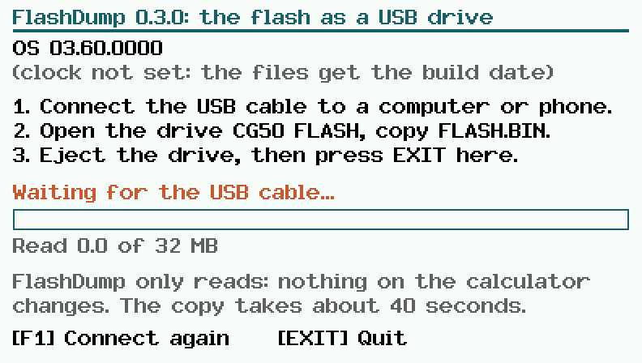

This area is for the calculators, for now, I hope you like it and hope some of this software helps you do something great!

Add-ins for the Casio **fx-CG50**, each tested on the real calculator. Download the `.g3a` from a
project's Releases page and copy it to the calculator in USB Flash mode.

### [C47](https://github.com/fxprgm/c47-cg)

The C47 RPN calculator, in its R47 form: 34-digit decimal maths, exact big integers, complex numbers, programs, equations and graphs, with the R47's own fonts.

### [FlashDump](https://github.com/fxprgm/flashdump-cg)

Copy the calculator's whole flash to a computer or phone: it shows up as a USB drive, nothing to install.

### [FastGraph](https://github.com/fxprgm/fastgraph-cg50)

A fast function grapher: six colour curves, pan and zoom.

### [CodeView](https://github.com/fxprgm/codeview-cg50)

Read your Casio BASIC programs and Python scripts with colours, indentation and six font sizes.

### [HP PPL](https://github.com/fxprgm/ppl-cg50)

Run HP Prime programs (.hpprgm, .ppl) on the CG50.

### [TI68k](https://github.com/fxprgm/ti68k-cg50)

A TI-89 / TI-92 Plus emulator.
